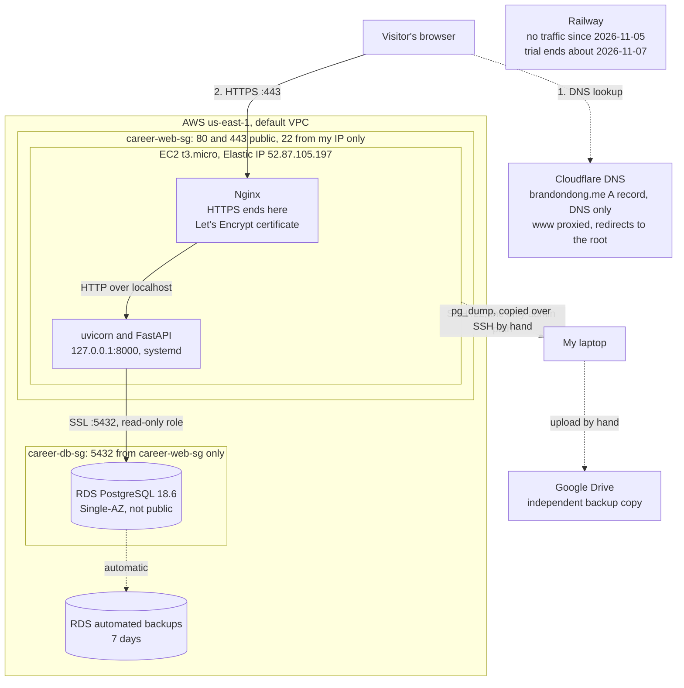

# career-platform

My resume site at **https://brandondong.me**: a FastAPI app with Jinja templates that reads my profile, experience, projects, skills and credentials from a database.

It ran first on an Azure VM (Sept 29 – Oct 12, 2026), then on Railway with PostgreSQL (Oct 12 – Nov 5, 2026), and now runs on AWS: EC2 for the app and RDS PostgreSQL for the database. Email for the domain runs on Zoho Mail, and Google Analytics 4 counts page views and outbound clicks after a visitor accepts.

- Submission index with links to all evidence: [docs/project-1-submission.md](docs/project-1-submission.md)
- Original spec and plans: [docs/superpowers/specs/](docs/superpowers/specs/) and [docs/superpowers/plans/](docs/superpowers/plans/)

## How it runs now (AWS)

| Piece | Where |
|---|---|
| App server | One EC2 `t3.micro` in `us-east-1a`, Ubuntu 26.04, 20 GB encrypted gp3 disk, IMDSv2 required |
| App process | uvicorn on `127.0.0.1:8000` under systemd: [deploy/career-platform.service](deploy/career-platform.service) |
| Web entry point | Nginx on ports 80 and 443: [deploy/nginx-career-platform.conf](deploy/nginx-career-platform.conf). Unknown hostnames and bare-IP requests are closed |
| Database | RDS PostgreSQL 18.6, `db.t4g.micro`, Single-AZ, 20 GB encrypted gp3, not publicly accessible, deletion protection on |
| Database login | The app uses `career_app`, a read-only role, over SSL with the server certificate verified (`sslmode=verify-full`) |
| Variables | `DATABASE_URL`, `ADMIN_USERNAME`, `ADMIN_PASSWORD` in `/etc/career-platform/env` on the instance (mode 640), never in Git |
| Network | `career-web-sg`: 80 and 443 public, 22 from my IP only. `career-db-sg`: 5432 from `career-web-sg` only |
| Domain | `brandondong.me` → Cloudflare A record (DNS only) → Elastic IP `52.87.105.197`. `www` is a proxied Cloudflare record that redirects to the root |
| Certificates | Certbot and Let's Encrypt on the instance cover the root and `aws.brandondong.me` (valid to 2027-02-03, renewal timer enabled); Cloudflare covers `www` |
| Health | `GET /healthz` returns 200 only when a profile can be read, 503 otherwise |

HTTPS ends at Nginx, which forwards plain HTTP over localhost, so the app trusts `X-Forwarded-Proto` (`app/main.py`). Without that, stylesheet links come out as `http://` and the page loads unstyled. That trust is only safe because uvicorn listens on `127.0.0.1` and Nginx overwrites the forwarded headers itself.

**When the database fails:** every page returns HTTP 503, the last profile read successfully stays visible, and sections say "temporarily unavailable" instead of claiming they're empty. An empty table still returns 200 with "No projects listed yet." After the database recovers, the next request shows real data again without a restart, because every request opens a new database session.

### Update path

Pushing to `main` no longer deploys anything. Commit and push, then update the server over SSH:

```bash
cd ~/career-platform && git pull --ff-only origin main
~/.local/bin/uv sync --locked --no-dev
sudo systemctl restart career-platform
```

Check with `curl https://brandondong.me/healthz`, and `journalctl -u career-platform -n 50` on the server.

### Local development

Local development stays on SQLite: `uv sync`, then `uv run uvicorn app.main:app --reload`. Tests: `uv run pytest` (on this laptop, `.venv/Scripts/python.exe -m pytest`, because Windows blocks the `pytest.exe` launcher). The Postgres-only tests run when `TEST_POSTGRES_URL` points at a local throwaway database (see the Railway plan).

### Setting it up from scratch

1. **Network:** create `career-web-sg` and `career-db-sg` in the default VPC with the rules above.
2. **Database:** create the RDS instance with the settings above, 7-day automated backups and a generated admin password kept outside the repository.
3. **Server:** import an SSH public key, launch the instance with Standard CPU credits and IMDSv2 required, attach an Elastic IP, and compare the SSH host key with the console output before connecting.
4. **Packages:** install `nginx`, `certbot`, `python3-certbot-nginx`, `postgresql-client-18` and `uv`, add 1 GiB of swap, and download the [RDS CA bundle](https://truststore.pki.rds.amazonaws.com/global/global-bundle.pem) to `/etc/ssl/rds/global-bundle.pem`.
5. **Data:** from the instance, because RDS can't be reached from outside, run `pg_restore --no-owner --no-privileges --exit-on-error` into the empty database. Then create `career_app` with SELECT only. Don't run `scripts/copy_to_postgres.py` here.
6. **App:** clone this repo to `~/career-platform`, run `uv sync --locked --no-dev`, write `/etc/career-platform/env`, and install the two files in `deploy/`.
7. **HTTPS and DNS:** point the name at the Elastic IP (DNS only), then run `certbot --nginx --redirect`. Certbot edits the Nginx file on the server, so copy the result back into `deploy/`.

## Architecture



Solid lines carry live traffic and dashed lines are lookups or backups. Railway has no line because it no longer receives traffic.

- Earlier web request on Railway and on Azure, with ports, protocols and where TLS ends: [docs/diagrams/request-path.md](docs/diagrams/request-path.md). It hasn't been updated for AWS.
- Email (incoming, outgoing, SPF/DKIM/DMARC checks) and analytics: [docs/diagrams/email-and-analytics.md](docs/diagrams/email-and-analytics.md). Mail doesn't touch the web host, so these paths didn't change.

## What I tested on AWS

Tested at `https://aws.brandondong.me` while Railway still served the domain, then repeated the page checks after cutover (2026-11-05 UTC).

| Test | Result |
|---|---|
| Data restore | All 7 tables matched the Railway backup manifest: row counts and content hashes |
| 8 pages, `/healthz`, CSS, JS | 200 with real data; an unknown path returns 404 |
| Compared with the live Railway site | Same content on all 8 pages, apart from the host text and blank lines on two pages |
| Admin login | No login, the public default and a wrong password are refused; my real login works |
| Reboot | Back in 22 seconds with no manual steps |
| Database cut off, with a fresh app process | Pages return 503 in about 10 seconds, no hang |
| Database restored | 200 within seconds, no app restart |
| Crash: `kill -9` on uvicorn | 502 for a few seconds, then systemd restarted it and `/healthz` returned 200 within 6 seconds |
| App stopped | Nginx stayed up and returned `502 Bad Gateway`, with `Connection refused` in its error log |
| Exposure from my laptop | Bare IP, unknown hostnames, port 8000 and RDS port 5432 are closed |
| Read-only role | Update, delete and create table are refused |
| Backup path | Dumped from RDS, copied to my laptop, restored locally; all 7 tables matched |
| Certificate renewal | `certbot renew --dry-run` succeeded for both names |
| After cutover | Public resolvers return the Elastic IP; pages 200 on the root domain; HTTP and `www` redirect; only the root record changed, plus the added `aws` record; mail records intact; test emails delivered in both directions through Zoho (outgoing landed in Junk at my LMU mailbox, the known issue below); certificate fingerprint in my browser matched the server |

**Not verified:** a restore from RDS automated backups.

## Backups and rollback

**Code.** Revert the bad commit and push: `git revert <sha>`, then `git push origin main`, then follow the update path above. Check afterward: `git log --oneline -1` on the server shows the expected commit, `curl https://brandondong.me/healthz` returns `{"status":"ok"}`, and the page shows the expected content.

**How the data is backed up.**

| Copy | Where | Frequency | Kept |
|---|---|---|---|
| RDS automated backups | AWS | Daily, automatic | 7 days |
| `pg_dump` export | My laptop and Google Drive, outside AWS | Weekly by hand, and before any change to the data | Last 4 weekly, plus every pre-migration backup until the semester ends |

Targets: I can accept losing up to **7 days** of data (RPO), because any lost edit can be redone from my resume, and recovering within **1 hour** (RTO). The weekly export isn't automated, so it only happens if I run it.

To take an export from my laptop:

```bash
ssh ubuntu@52.87.105.197 'set -a; . /etc/career-platform/env; set +a; umask 077; pg_dump -Fc --no-owner --no-privileges -d "$DATABASE_URL" -f ~/rds-backup.dump'
scp ubuntu@52.87.105.197:rds-backup.dump ~/backups/career-platform/rds-$(date -u +%Y%m%dT%H%M%SZ).dump
ssh ubuntu@52.87.105.197 'shred -u ~/rds-backup.dump'
```

Keep exports out of this repository, and check each one with `sha256sum`.

**How to restore.**

1. Copy the dump to the instance. RDS can only be reached from there.
2. Stop the app, connect as the RDS admin, and restore into an empty database with `pg_restore --no-owner --no-privileges --exit-on-error`.
3. Grant `career_app` SELECT on all tables and sequences again.
4. Compare row counts and content hashes with the backup's manifest, start the app, load the pages, and delete the dump from the instance.

To recover from AWS's own backups instead, restore the RDS instance to a point in time. That creates a new database with a new endpoint, so `DATABASE_URL` has to change. I haven't tested this path.

**Writes after cutover.** The app has no routes that write to the database, so the only writes are ones I make by hand (the last was the "Cloudflare DNS" skill, id 10, on 2026-10-12). A rollback to an older dump would lose any such edits, so list them before restoring and re-apply them afterward.

**Schema.** The schema came with the dump, and the app doesn't change it. Rolling back code that changed a model doesn't change the table back; that would need a hand-written `ALTER TABLE` until the project adopts a migration tool.

**Hosting.** While the Railway trial lasts, DNS can go back by restoring the root record to `CNAME gvb8rrd4.up.railway.app`. After that there's no second host. The Azure VM was deleted on 2026-10-16.

**Careful with deletion.** Terminating the EC2 instance deletes its disk but not the data, which lives on RDS. Deleting the RDS instance is the dangerous action, which is why deletion protection is on.

## Who owns what

On AWS I've taken back most of what Railway handled: the OS, patching, the web entry point, certificates, deploying and keeping the app running. AWS runs the database server, patches it and takes automated backups, so PostgreSQL itself is the one thing that got easier compared with Railway's unmanaged Postgres.

On Railway (written 2026-10-21):

Railway now owns the host, the OS, routing, TLS certificates and their renewal. I still own the code, runtime versions, settings and secrets, the data and schema, DNS, testing, and recovery. Railway hosts PostgreSQL but calls it unmanaged, so backups and restores are mine too.

Compared with Tuesday's Azure setup, the firewall rule, nginx `server_name`, Certbot, Let's Encrypt domain validation and the renewal timer all moved to Railway. Getting HTTPS took one custom hostname and two DNS records. What I still had to do myself was DNS, the start command, secrets, and moving the data.

| Layer | Azure VM | Railway | AWS |
|---|---|---|---|
| Operating system and patches | Me (Ubuntu 24.04) | Railway | Me (Ubuntu 26.04, automatic security updates) |
| Runtime | Me: Python 3.12 and packages via `uv` on the VM | Shared: I pin Python and packages in Git; Railpack installs them | Me: Python 3.12 and packages via `uv` on the instance |
| Web entry point | Me: Azure NSG rules and Nginx | Railway's edge | Me: security groups and Nginx |
| TLS certificate and renewal | Me: Certbot and its systemd timer | Railway (root); Cloudflare (`www`) | Me: Certbot and its timer (root); Cloudflare (`www`) |
| Application code | Me | Me | Me |
| Configuration and secrets | Me: `.env` on the VM | Me, stored in Railway variables. Railway holds them, and the 2026-10-21 incident shows that's a risk I still have to respond to by rotating them | Me: `/etc/career-platform/env` on the instance |
| Database software | Me: SQLite library on the VM | Railway runs the Postgres container; version and settings are still my choice | AWS runs and patches RDS; version and settings are still my choice |
| Data and backups | Me | Me (unmanaged Postgres) | Shared: AWS keeps 7 days of automated backups; I keep an export outside AWS |
| DNS | Me (Cloudflare) | Me (Cloudflare) | Me (Cloudflare) |
| Keeping the app running | Me: systemd `Restart=always`, Nginx restart drop-in | Railway's restart policy and health check | Me: systemd `Restart=always`, and AWS for the hardware |
| Deploying | Me: SSH, `git pull`, restart | Railway builds each push, when its build system is up | Me: SSH, `git pull`, restart |

## How the migration kept my data

**Railway to AWS (2026-11-03 to 2026-11-05).** `pg_dump` ran inside Railway's Postgres container over `railway ssh`, so the database was never exposed publicly. I tested that backup by restoring it locally, kept a copy on Google Drive, and restored it into the empty RDS database from the EC2 instance. All 7 tables matched the manifest taken at backup time. DNS moved only after the AWS copy passed its tests at `aws.brandondong.me`, and the switch to the new certificate took about 28 seconds.

**SQLite to Railway (October).**

I took an online SQLite backup on the VM and checked that it reads. Then I copied it into Railway Postgres with `scripts/copy_to_postgres.py`, which runs in one transaction and resets the id sequences. Finally I compared the two databases table by table: row counts, rows matched by id, and content hashes all matched. Details, what Git moved versus what needed another method, and two checks that weren't done: [docs/railway-migration-results.md](docs/railway-migration-results.md). Plan: [docs/superpowers/plans/2026-10-08-railway-migration.md](docs/superpowers/plans/2026-10-08-railway-migration.md). There's no separate Railway spec: the plan quotes my request as its spec.

## Decisions

### Which architecture on AWS?

I chose **EC2 with Single-AZ RDS** over **EC2 with local PostgreSQL** because a failure on one server shouldn't take the other down with it, and the database shouldn't sit on the public-facing VM. My instructor also wanted this migration to use RDS. I accept about $14/month more on a paid account, and one more service to set up and secure.

I first chose local PostgreSQL to save money, at about $13/month against $27. Lambda with API Gateway and RDS would have needed application changes, a database connection strategy and somewhere else for static files.

This has limits. If RDS goes down, the site is still mostly down, because every page needs the database. If someone gets into the VM, they can read `DATABASE_URL` and reach RDS. That's why the app uses a read-only role, so that login can't change or delete data.

### Should a three-developer startup move from an Azure VM to Railway?

**Recommendation: move to Railway, but keep the exit open.**

- **Cost:** Railway used about $0.17 in four days for a small web service plus Postgres. A small Azure VM costs a fixed monthly amount whether it's busy or idle. At this size Railway is cheaper in money. The bigger saving is time.
- **Our hours:** the Azure path took two sessions of firewall rules, nginx, systemd, Certbot and renewal timers. On Railway the same result took one domain and two DNS records, and each update is now a `git push`. For three developers, those hours belong on the product.
- **Control:** we give up the OS, the proxy configuration and the TLS details. In return Railway's choices become our constraints: a deprecated config-as-code format, one custom domain on the trial, and billing on the database proxy.
- **Reliability:** Railway restarts failed deploys, keeps the old deploy serving while a new one builds, and refuses a deploy whose health check fails. The VM had one process supervisor and one machine. But Postgres on Railway is unmanaged, so backups are still on us. One issue is that Railway can stop builds at times, and this is entirely out of our control. With Azure, we are managing our own server essentially, so whether the VM is up and running is dependent on us. This, in my opinion, is a downside of Railway.
- **What would change my answer:** data-residency or compliance rules that need our own network, steady high traffic where usage pricing beats nothing, or a need for anything Railway doesn't run, like custom kernels or GPUs. A second region on a paid plan would also change the cost picture.

### Managed email (Zoho) or running my own mail server?

I like the convenience of Zoho, similar to why I would choose Railway over Azure for application hosting, so I would choose Zoho. However, I never really tried the email server that comes with Microsoft 365. I can imagine that for some companies which prefer the vertical integration of Microsoft products, this could be an advantage. Additionally, we have had some issues with sending emails via Zoho, although I believe this has more to do with the domain that I am registered under. After troubleshooting some email settings with Claude Code, it seems that my Microsoft email is automatically moving emails from my Zoho email to the spam folder, as there was nothing in the email headers that suggested there was a missing setup or certificate on the Zoho end. If I'm using an email that is verified on a Microsoft product, like Azure, I wonder if Microsoft Outlook would automatically move the email as well. To the convenience point, Zoho is able to handle spam filtering, sender reputation, and TLS, whereas if I were to use Postfix on the VM, I would have had to do all of that myself. 

## Failures I investigated

*Summaries written afterward (2026-10-21); the linked records are the originals.*

**1. Application and database: the site would have served an empty database (Azure migration, 2026-09-29).** Record: [docs/evidence/ex03.md](docs/evidence/ex03.md) §3 and the [Azure plan's corrections](docs/superpowers/plans/2026-09-24-azure-vm-migration.md#corrections-to-the-spec-read-first). Real, not a lab exercise.
- **Symptom:** the migration plan's inspection found the site would load with the fallback banner instead of my profile.
- **Check:** `data/career_platform.db` was 0 bytes with no tables, and nothing in the code created them.
- **Diagnosis:** the database had never been filled; the app wasn't broken.
- **Repair:** loaded my resume's data into the database on the laptop, then copied the file to the VM.
- **Repeated check:** the laptop and VM copies had matching SHA-256 hashes, `integrity_check` returned `ok`, and the page showed my headline with no fallback banner (plan Verify results, 2026-09-29).

**2. DNS and TLS: wrong certificate after the Railway cutover (2026-10-12).** Record: [docs/evidence/ex05.md](docs/evidence/ex05.md). Real, not a lab exercise.
- **Symptom:** `https://brandondong.me` failed with a certificate name mismatch after `@` was pointed at Railway.
- **Checks:** both public resolvers returned Railway's address and the right TXT token; `openssl s_client` showed Railway's generic `*.up.railway.app` certificate; `curl -k` reached Railway's 404 instead of my app; CAA and DNSSEC were ruled out.
- **Diagnosis:** Railway hadn't finished verifying the domain, which gates both the certificate and the routing.
- **Repair:** Railway staff re-triggered verification after a support request; no DNS change.
- **Repeated check:** at 2026-10-13 02:57 UTC the same commands showed `CN=brandondong.me` and HTTP 200 from my app.

Also recorded: the Railway migration plan's 11 compatibility findings and how each was fixed ([plan](docs/superpowers/plans/2026-10-08-railway-migration.md#what-the-inspection-found-read-first)), the GA4 consent bug ([ex06.md](docs/evidence/ex06.md) §3, commit `48f342a`), and the blocked deploy of 2026-10-21 ([results](docs/railway-migration-results.md#database-failure-handling-commit-7c4fce6-2026-10-21)).

## Limitations

- **`ADMIN_PASSWORD` may need rotating.** Railway advised rotating all secrets after its 2026-10-21 incident, and I can't confirm that happened. The same admin password was copied to AWS.
- **One server, one zone.** The app runs on one instance and the database is Single-AZ, so an outage in that zone takes the site down.
- **Every page needs the database,** including `/privacy`. An RDS outage takes the site down, apart from the remembered profile.
- **Backups outside AWS are manual.** The weekly export only happens if I run it, and it depends on my laptop.
- **RDS backup restore is untested.** I've tested restoring a `pg_dump`, but not a point-in-time restore.
- **SSH depends on my IP.** The rule allows one address, so it has to be updated when I change networks.
- **Deploys are manual.** A push to `main` changes nothing until I update the server.
- **No fallback host** once the Railway trial ends. The Azure VM was deleted on 2026-10-16.
- **One profile copy per process.** The remembered profile lives in each app process, so a process that starts during an outage shows "Profile temporarily unavailable".
- **No IPv6 at the root.** `brandondong.me` has no AAAA record, so an IPv6-only visitor can't reach it ([dns-final.md](docs/evidence/dns-final.md)).
- **New messages from my domain land in Junk** at my LMU mailbox, even though SPF, DKIM and DMARC pass. Cause unverified ([zoho-header-check.md](docs/evidence/zoho-header-check.md)).
- **DMARC is `p=none`**, so it only monitors; spoofed mail isn't rejected yet.
- **Unverified Azure evidence:** no controlled VM restart was recorded, and the VM's private IP and the 443 NSG rule listing were never saved ([operate-the-vm plan](docs/superpowers/plans/2026-10-01-operate-the-vm.md#verify-results)).
- **Not done:** a message sent before the MX records existed ([ex06.md](docs/evidence/ex06.md)), a deliberate change to the source data before the migration, and a side-by-side comparison of the rendered pages ([results](docs/railway-migration-results.md)).
- **Schema changes** have no migration tool; `create_all` never alters existing tables.

## Costs, expiration dates and cleanup

| Service | What it is | Kind | Cost so far | Ends or renews | Cleanup plan |
|---|---|---|---|---|---|
| AWS EC2 `t3.micro` | App server | Compute | Estimate: $7.59/month | Runs until terminated | Terminate when done |
| AWS EBS gp3, 20 GB | Instance disk | Retained storage | Estimate: $1.60/month | Deleted with the instance | Deleted on termination |
| AWS public IPv4 (Elastic IP) | Fixed address | Other | Estimate: $3.65/month | Bills while allocated, even when idle | Release it after terminating the instance |
| AWS RDS `db.t4g.micro` | Database server | Compute | Estimate: $11.68/month | Runs until deleted | Take a `pg_dump`, turn off deletion protection, then delete |
| AWS RDS gp3, 20 GB | Database storage | Retained storage | Estimate: $2.30/month | Deleted with the database | Deleted with the database |
| AWS backups and data transfer | RDS backups, traffic out | Other | About $0 at this size | n/a | n/a |
| Railway web service | App container | Compute | Trial credit: $0.59 of $5 used as of 2026-10-22 00:18 UTC (`railway usage`) | Trial ends around **2026-11-07** (dashboard on 2026-10-12: 26 days left), or at $5 | Move to AWS after the midterm, before the trial ends; then delete the Railway project |
| Railway Postgres | Database container plus its volume (`/var/lib/postgresql/data`) | Compute + retained storage | Included above | Same trial | Take a `pg_dump` before deleting; the volume is deleted with the project |
| Domain `brandondong.me` | Registration at Namecheap | Other | Not recorded here; check the Namecheap order | Expires **2027-10-01** (WHOIS) | Decide on renewal before then |
| Cloudflare | DNS, `www` redirect | Other | $0, free plan | n/a | Keep while the domain is in use |
| Zoho Mail | Mailbox for my domain | SaaS | $0 (plan not recorded; check Zoho's admin console) | n/a | Keep; remove MX records first if ever cancelled |
| Google Analytics 4 | Analytics | SaaS | $0 | n/a | Remove the tag (`GA_MEASUREMENT_ID=""`) if no longer wanted |
| Azure VM, disk, static IP | Previous host | Compute + retained storage | About $6/month for the IP and disk while deallocated, before deletion | Deleted 2026-10-16 | Done. Only `NetworkWatcher_northcentralus` remains, which doesn't bill |

**AWS total: about $26.82/month** (2026-11-03 us-east-1 public prices, 730 hours), or about $33 if traffic and backups run high. This is an estimate, not a bill. My monthly budget alert is set at $10, so it will fire about 11 days into a full month. The account is on the paid plan with no credits (Billing → Credits showed $0.00 on 2026-11-05), so this is real money. Alerts aren't a spending cap.

## What's next

- [x] Send test emails through Zoho in both directions.
- [ ] Rotate `ADMIN_PASSWORD`, unless it was already rotated after the Railway incident.
- [ ] Delete the Railway project once I'm confident in AWS, and no later than when the trial ends.
- [ ] Set a budget amount that means something at this cost.
- [ ] Run the weekly export, and consider automating it.
- [ ] Test a point-in-time restore of RDS.
- [ ] At the end of the semester, decide whether to keep paying, move to a cheaper host or delete the site.

## Reflection

I understand the different parts of my site better. I know that Railway is where we are hosting the application, and that it runs the code by being connected to my GitHub Repository. I understand the limitations and benefits of Railway over Azure, which is where we originally hosted our application. Going through all of the manual steps of Azure made me realize why IaaS, PaaS, and SaaS products are successful, but additionally, it made me understand the power of a CLI or MCP in combination with a coding agent. In a way, if you prefer control and personalization, I can see how using a coding agent with access to the Azure CLI can be just as effective as Railway. If I were to change something, I would back up Postgres, maybe in a docker container, as my only copy is in Railway's database. 

## History: Railway (Oct–Nov 2026)

The site ran on Railway from 2026-10-12 until cutover to AWS on 2026-11-05: service `career-platform` in project `resilient-endurance`, built from GitHub `main` by Railpack, with Railway PostgreSQL over its private network. Railway paused all builds platform-wide during a security incident on 2026-10-21. Records: [Railway plan](docs/superpowers/plans/2026-10-08-railway-migration.md) and [results](docs/railway-migration-results.md).

## History: Azure VM (Sept–Oct 2026)

The site first ran on an Azure VM (`vm-career-platform`, Ubuntu 24.04, North Central US) as uvicorn with 2 workers behind Nginx under systemd, with SQLite and a Let's Encrypt certificate from Certbot. SSH was key-only and allowed only from my laptop's public IP; the app listened on `127.0.0.1:8000`, and only Nginx on ports 80 and 443 was public. The VM was deleted on 2026-10-16, with the instructor's verbal approval (given in person, about 2026-10-13).

**What had to be configured to survive a restart** *(written afterward, 2026-10-21)*: the app's systemd unit with `systemctl enable` (start at boot) and `Restart=always`; Nginx enabled at boot (the Ubuntu default) plus a drop-in with `Restart=on-failure`; and an absolute `DATABASE_URL`, so the app opened the real SQLite file no matter which directory systemd started it in. A controlled restart test was never recorded, so this is unverified.

- [Azure VM migration plan](docs/superpowers/plans/2026-09-24-azure-vm-migration.md)
- [Operate the VM (Nginx, systemd)](docs/superpowers/plans/2026-10-01-operate-the-vm.md)
- [How the site was secured on the VM](docs/how-this-site-is-secured.md) (Exercise 04, my HTTPS explanation)
- [Exercise 03: the VM, SSH rule and build issues](docs/evidence/ex03.md)
