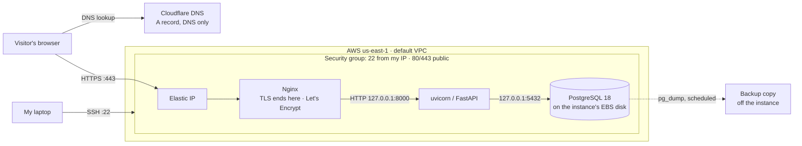

# AWS migration: notes

Migration of the career site from Railway to AWS, following the course guide (`guides/aws-migration.md`, sessions 17–18). Railway keeps serving `brandondong.me` until the AWS copy passes its checks.

Connection strings, passwords and keys are left out of this file on purpose.

## 1. Budget and architecture (2026-11-03)

**Account.** Because of an account issue, this AWS account is on the **paid plan**, not the Free plan the guide assumes. Usage is billed as real charges unless credits show on the Billing → Credits page. I've told my instructor.

**Budget.** Monthly cost budget, **$10**, email alerts (the guide's setting for accounts without the Free plan, where a zero-spend budget would fire right away). The estimated plan costs more than $10/month, so alerts partway through the month are expected. A budget is an alert, not a cap.

**Options compared** (rough us-east-1 on-demand prices from memory; section 6 checks them against current pricing):

| Option | ~Monthly | Tradeoff for this app |
|---|---|---|
| EC2 + local PostgreSQL | ~$13 | No code changes; I run backups; app and database share one failure point |
| EC2 + Single-AZ RDS | ~$27 | No code changes; AWS handles patching and backups; one more service and about $14/month more |
| Lambda + API Gateway + RDS | ~$15, +~$33 with a NAT gateway | Needs an ASGI adapter, a Postgres connection strategy and somewhere else for static files |

**Decision:**

> I chose **EC2 with local PostgreSQL** over **EC2 with Single-AZ RDS** because **cost is my priority** (about $13/month instead of $27 on a paid account), and I accept that **I'm responsible for database backups, patching and monitoring, and that the app and database share one point of failure**.

**Requirements check:** the app runs unchanged (`DATABASE_URL` points at localhost); data moves with `pg_dump`/`pg_restore` (PostgreSQL 18 on both sides); PostgreSQL stays private only if it listens on `127.0.0.1` *and* the security group has no 5432 rule, and both need verifying in section 10; every service is on a paid plan.

**Differences from the guide, sent to my instructor for review before provisioning:**
1. Section 7 (RDS) is replaced by installing PostgreSQL 18 on the instance.
2. Section 8's "no PostgreSQL on the instance" doesn't apply.
3. Backups are mine: a scheduled `pg_dump` to storage off the instance, in place of RDS automated backups.
4. A t3.micro has 1 GiB RAM for both uvicorn and Postgres: add swap, or use t3.small (allowed by the policy).

**Status: approved by my instructor (2026-11-03). Replaced the same day by EC2 with RDS; see [Decision change](#decision-change-ec2-with-rds-2026-11-03). The differences above and the request path below describe the earlier decision.**

**Request path (planned):**

## 2. Backup and test restore (2026-11-03)

**What was backed up.** The Railway PostgreSQL database (all 7 tables). The app stores no uploaded files (no upload handlers in `app/`), so the database is all the live data.

**Route.** `pg_dump` ran *inside* Railway's Postgres container over `railway ssh`, and the archive streamed back to my laptop. The database was never exposed publicly: Railway's TCP proxy stayed off, and there was no `DATABASE_PUBLIC_URL` before or after.

- An SSH key was registered on my Railway account for the backup and **removed afterward** (`railway ssh keys list` is empty).
- **Host key: trust on first use, unverified.** Railway publishes no fingerprint for `ssh.railway.com`. Its forum says the keys change without notice. The key seen in 6 of 6 scans (`ED25519 SHA256:+S1xg92FrnHz6pY3bpkmh1OGtWQGNANXilPzlxA7B1g`) was pinned in a known_hosts file used only for this session, with strict checking and no agent forwarding. Evidence that it was the real database: the dumped counts match the October migration record, plus the one skill added after it (below).
- The SSH key used (`isba4775_azure`) has **no passphrase**.

**Backup**

| Item | Value |
|---|---|
| Taken | 2026-11-03 20:52:00 UTC |
| Source | Railway Postgres, PostgreSQL 18.6; `pg_dump` 18.6 |
| Format | `pg_dump -Fc --no-owner --no-privileges` (21,836 bytes) |
| SHA-256 | `f44551ab144d23fa9b9e9bd923c9b997d405ec701ab12c88c2e2e3bdd7309d77` |
| Stored | `~/backups/career-platform/railway-20261103T205200Z.dump`, with `.dump.sha256` and `.manifest.txt`, outside the repository |
| Independent copy | Google Drive (my account), folder `career-platform-backups`, private (owner only, inherited sharing off): the dump, `.sha256` and manifest. Downloaded back and checked: SHA-256 matches (2026-11-03 21:43 UTC) |

**Manifest at backup time** (row count and md5 of each table's rows ordered by `id`, taken over the same SSH route):

| Table | Rows | Row hash | Compared with October record |
|---|---|---|---|
| profiles | 1 | `3d8fe483…` | 1 ✅ |
| experiences | 3 | `d2728362…` | 3 ✅ |
| projects | 1 | `671ec58a…` | 1 ✅ |
| skills | 10 | `c899eae4…` | 9 + "Cloudflare DNS" (id 10) ✅ |
| credentials | 6 | `2b52dfc6…` | 6 ✅ |
| content_pieces | 0 | empty | 0 ✅ |
| contact_submissions | 0 | empty | 0 ✅ |

(The October hashes used a different method across SQLite and Postgres, so only the counts can be compared with them.)

**Test restore.** Into a new database in a local `postgres:18.6` container listening only on `127.0.0.1`. Railway was not queried during the restore check.

| Check | Result |
|---|---|
| Checksum before restore | `sha256sum -c` OK |
| `pg_restore --exit-on-error` | exit 0 |
| Restore time | **836 ms** (second restore into a fresh database, timed) |
| Counts and row hashes vs manifest | all 7 tables identical |
| Representative records | profile "Brandon Dong"; experiences Western Express, LMU Ice Hockey, Tutor; skill id 10 "Cloudflare DNS" |
| Sequences | restored (`skills_id_seq` = 10, `credentials_id_seq` = 6, …) |
| App against the restored copy (local uvicorn) | `/healthz` 200 `{"status":"ok"}`; `/`, `/experience`, `/projects`, `/skills`, `/credentials`, `/privacy` 200; profile and "Cloudflare DNS" rendered; no "temporarily unavailable" fallback |
| Cleanup | test app stopped, container and its password removed |

**Recovery targets** (confirmed 2026-11-03):

| | Target | Reasoning |
|---|---|---|
| Backup frequency | Weekly, plus one before every migration step that touches data | Data only changes through my own admin edits, a few times a month |
| Retention | Keep the last 4 weekly backups and every pre-migration backup until the semester ends | Covers a month of mistakes |
| RPO (acceptable data loss) | 7 days | Any lost edit can be redone from my resume |
| RTO (acceptable recovery time) | 1 hour | Restore takes under a second; the time goes into provisioning and DNS |

**Still to do for section 2:**
- [x] Copy the backup to independent storage (not this laptop): Google Drive, checksum verified
- [x] Confirm or change the RPO/RTO above

## 3. IAM user (2026-11-03)

Created in the account owner's console session:

| Item | Value |
|---|---|
| User | `isba-student`, IAM user (no Organizations or Identity Center, so the console doesn't offer that choice) |
| Console access | Autogenerated password, changed at first sign-in |
| Policies | `SignInLocalDevelopmentAccess`, `AmazonEC2ReadOnlyAccess`, plus `IAMUserChangePassword` (added automatically by "must create a new password") |
| MFA | Passkey on my iPhone, on both the root user and `isba-student`; assigned from the owner's session |
| Access keys | None |
| Verified | Signed in as `isba-student` with MFA |

The sign-in URL and password are kept privately, outside the repository.

## 4. CLI and agent connection (2026-11-03)

| Item | Value |
|---|---|
| AWS CLI | 2.39.3 (guide needs 2.35.0 or later) |
| Profile | `isba-4775`, region `us-east-1`, temporary session from `aws login` |
| Agent Toolkit | AWS skills and the `aws-mcp` server installed |
| `you-should-know` plugin | Enabled |

**Connection check**

| Check | Result |
|---|---|
| `aws sts get-caller-identity` | My account, `arn:aws:iam::<account-id>:user/isba-student` (not root) |
| `aws ec2 describe-instances` | Empty list |
| `aws rds describe-db-instances` | AccessDenied, expected until section 5 |
| `aws iam list-attached-user-policies` | AccessDenied, expected until section 5 |
| AWS MCP server, `GetCallerIdentity` | Same account and user as the CLI, after the fix below |

**Difference from the guide: `aws-mcp` needed a profile.** The guide says the MCP server uses the same IAM user as the CLI, but the entry the setup wrote to `~/.claude.json` named no profile, and `AWS_PROFILE` wasn't set. The server failed with "expired or invalid AWS credentials" while the CLI worked. It was most likely reading my older `default` profile; I didn't check which user that profile belongs to.

Fix: added `AWS_PROFILE=isba-4775` to the `env` of the `aws-mcp` entry and restarted Claude Code. The identity check then passed. This only selects the login, so the server has the same permissions as `isba-student`.

## 5. Deployment permissions (2026-11-03)

Created `ISBA4775EC2Migration` from the course policy JSON in the root session, attached it to `isba-student`, and signed back in as `isba-student`.

Checked with `--dry-run`, so nothing was created:

| Check | Result |
|---|---|
| Launch `t3.micro` or `t3.small` with IMDSv2 required | Allowed |
| Launch `t3.large` | Denied |
| Launch with `HttpTokens=optional` | Denied |
| `aws rds describe-db-instances` | Allowed, empty list |
| `aws s3api list-buckets` | Denied (the policy has no S3 actions) |

## Decision change: EC2 with RDS (2026-11-03)

My instructor wants this migration to use RDS, so this replaces the section 1 decision:

> I chose **EC2 with Single-AZ RDS** over **EC2 with local PostgreSQL** because **a failure on one server shouldn't take the other down with it, and the database shouldn't sit on the public-facing VM**, and I accept **about $14/month more on a paid account, and one more service to set up and secure**.

**Limits of that reasoning.** If the database goes down, the site still can't show most of its content: pages return 503 with the last good profile. If someone gets into the VM, they can read `DATABASE_URL` and reach RDS from it, so the VM still has to be locked down.

**Other decisions**

| Decision | Choice |
|---|---|
| Backups | RDS automated backups for 7 days, plus a `pg_dump` export to Google Drive on the section 2 schedule. No S3, because the guide doesn't use it |
| Instance size | `t3.micro` |
| HTTPS | Nginx and certbot, as in the guide. For `brandondong.me` this means a short window at a quiet hour after DNS moves |
| Deadline | Railway dashboard shows 4 days left on 2026-11-03, so cutover has to finish by about 2026-11-07 |

## 6. Cost estimate (2026-11-03)

Prices come from AWS's public Price List files for us-east-1, published between 2026-10-29 and 2026-11-03. `isba-student` can't call the Pricing API. Monthly figures use 730 hours.

| Item | Rate | Monthly |
|---|---|---|
| EC2 `t3.micro`, Linux | $0.0104/hour | $7.59 |
| EBS gp3, 20 GB | $0.08/GB-month | $1.60 |
| Public IPv4 (Elastic IP) | $0.005/hour | $3.65 |
| RDS `db.t4g.micro`, PostgreSQL Single-AZ | $0.016/hour | $11.68 |
| RDS gp3, 20 GB | $0.115/GB-month | $2.30 |
| RDS backups | $0.095/GB-month above the free allocation | about $0 |
| Data transfer out | First 100 GB/month free, then $0.09/GB | $0 |
| **Total** | | **$26.82** |

**Against the $10 budget:** $16.82 over, or 2.7 times the budget. At about $0.88/day, the alert fires around day 11 of a full month. High case: **$33.22**, with 150 GB of transfer and 20 GB of charged backups.

**Choices checked:** `db.t4g.micro` is $1.46/month cheaper than `db.t3.micro`. RDS adds $13.98/month over local PostgreSQL ($12.84).

**Not confirmed:** this is an estimate, not a bill. The size of the free backup allocation wasn't confirmed, so the high case assumes the worst. Credits aren't included: `isba-student` can't see them, so check Billing → Credits as the account owner.

## 7. RDS database (2026-11-03)

| Item | Value |
|---|---|
| Identifier | `career-platform-db`, database `career_platform`, admin `career_admin` |
| Engine and class | PostgreSQL 18.6, `db.t4g.micro`, Single-AZ, `us-east-1a` |
| Storage | 20 GB gp3, encrypted, autoscaling off |
| Network | Not publicly accessible; `career-db-sg` (`sg-0aa0e6299427934b4`) allows 5432 from `career-web-sg` only |
| Backups | Automated, 7 days; deletion protection on |
| Admin password | Generated to a private file outside the repository, never printed |

Status checked 2026-11-04 through the CLI: `available`, not public.

## 8. EC2 instance (2026-11-04)

| Item | Value |
|---|---|
| Instance | `i-094bfdbbd437beec8`, tag `career-platform`, `us-east-1a` |
| Image | `ami-0bfc5cae5711ffac8`, Ubuntu 26.04 server, Canonical owner `099720109477`, x86_64 |
| Compute | `t3.micro`, Standard CPU credits, IMDSv2 required |
| Storage | 20 GB gp3, encrypted (`vol-0ddfc737d27cadef0`) |
| Address | Elastic IP `52.87.105.197` |
| Security group | `career-web-sg` (`sg-08426db0e2212d3f4`): 22 from my IP only, 80 and 443 public |
| Key pair | `career-platform-aws`, new ed25519 key with a passphrase; only the public half was imported |

**Host key check:** ED25519, ECDSA and RSA fingerprints from the instance's console output all matched a scan of the Elastic IP.

| Type | Fingerprint |
|---|---|
| ED25519 | `SHA256:8pzaGRBohQV29sslozqUDmCd67atbhA2XhtkVWDMPXQ` |
| ECDSA | `SHA256:vN/fB3+VU1P9nvncd6vF+4/2JwSfcF6n0HnXivvFYLI` |
| RSA | `SHA256:xc28bMIcLQ3EFrDRe9ficHBQBJqCD9SGwJrNf0MGIAg` |

## 9. Deploy and restore (2026-11-04)

**Deviations from the plan**
1. Order: the security groups were created with RDS, and the SSH key just before EC2. Task 1 (site text) ran after both, before the server needed the code.
2. My IP changed overnight, so the SSH rule moved to my new address (`/32`, one address only). The rule needs updating whenever I change networks.

**Task 1:** footer and privacy page now name AWS (`86f67b7`). 137 tests passed, 2 skipped.

**Task 5, server setup:** packages updated, 1 GiB swap, RDS CA bundle installed, branch `aws-migration` cloned. `pg_restore` 18.6, Python 3.12.16, automatic updates enabled.

**Task 6, restore** (from `railway-20261103T205200Z.dump`, run on the instance)

| Check | Result |
|---|---|
| Checksum | Matches `f44551ab…`, on the laptop and on the instance |
| Connection | PostgreSQL 18.6, TLS 1.3, `sslmode=verify-full` |
| Database before restore | 0 tables |
| `pg_restore --no-owner --no-privileges --exit-on-error` | Exit 0, 201 ms |
| Counts and row hashes vs manifest | All 7 tables identical |
| Sequences | `skills_id_seq` 10, `credentials_id_seq` 6, others match row counts |
| `career_app` role | Can read; update, delete and create table all refused; not a superuser |
| Cleanup | Dump and passwords shredded from the instance |

**Task 7, app and Nginx**

| Check | Result |
|---|---|
| Services | `career-platform` and `nginx` active and enabled |
| Env file | `/etc/career-platform/env`, mode 640, `root:ubuntu`, three variables, admin values copied from Railway |
| Listeners | uvicorn on `127.0.0.1:8000` only; Nginx on 80 and 443 |
| `/healthz` | 200 `{"status":"ok"}` directly and through Nginx |
| App database connection | `career_app`, SSL on, TLS 1.3 |
| From the laptop | Named host 200; bare IP, unknown host, port 8000 and RDS 5432 all closed |
| Pages vs live Railway site (8 pages) | Same content. Differences: footer, privacy host line, and blank lines on `/` and `/about` |

**More deviations**
3. Task 6 didn't need the local comparison restore. The hash query reproduced the manifest's hashes exactly, so RDS was compared with the manifest directly.
4. Task 6 step 1 (no edits since the backup) was checked after the restore, by comparing live pages with AWS, not before it.
5. Nginx also rejects unknown hostnames on 443 (`ssl_reject_handshake`), which the plan only specified for port 80.
6. A copy of the env file stays in `~/secrets/career-platform/server-env` on the laptop, because the admin values won't be recoverable from Railway after the trial.

**Not yet tested:** HTTPS, reboot recovery, database failure, real admin login and the backup path. These are Tasks 8 and 9.

## 10. Test subdomain (2026-11-04)

Records saved first in `docs/evidence/dns-before-aws.md`. Added `A aws.brandondong.me 52.87.105.197`, DNS only, with `cf`. Comparing the full record list before and after: 10 records became 11, none removed or changed.

**HTTPS.** Let's Encrypt certificate for `aws.brandondong.me` from `certbot --nginx --redirect`, registered without an email. Valid to 2027-02-02.

| Check | Result |
|---|---|
| `https://aws.brandondong.me/healthz` from the laptop | 200, certificate verified |
| HTTP | 301 to HTTPS, path and query kept |
| Stylesheet link | `https://` |
| Bare IP on 80 and 443 | Closed |
| `certbot.timer` | Enabled |
| `certbot renew --dry-run` | First run failed with Let's Encrypt `rateLimited: Service busy; retry later`, before any domain check. Retried once: succeeded |

**Deviation 7.** certbot edited the Nginx file on the server, so `deploy/nginx-career-platform.conf` no longer matches it. Don't reinstall the Git copy over it. At cutover, edit `server_name` on the server, let certbot expand the certificate, then copy the final server file back into Git. This changes Task 10 step 2.

**Task 9, test results** (`https://aws.brandondong.me`, 2026-11-05 UTC)

| Test | Result |
|---|---|
| 8 pages, `/healthz`, CSS, JS | 200; an unknown path returns 404 |
| Real data | "Cloudflare DNS" on `/skills`, experiences on `/experience`, no outage banner |
| Admin | No login, public default login and wrong password: 401. Real login: 200 |
| Reboot | `/healthz` back in 22 s with no manual steps; services and swap survived |
| Database cut off, existing connection | Kept working (security groups don't drop open connections) |
| Database cut off, app restarted | `/healthz` and pages 503 in about 10 s, no hang |
| Rule restored | 200 within seconds, no app restart |
| Exposure | Bare IP, unknown host, port 8000 and RDS 5432 closed from the laptop |
| Log retention | Nginx `rotate 14` daily, matches the privacy page |
| SSH logins | 20 accepted, all public key from my IP; 0 failed |
| Backup path | `pg_dump` on the instance as `career_app`, copied to the laptop, checksum matched, restored into local `postgres:18.6`: all 7 tables match the Railway manifest |

Backup: `~/backups/career-platform/rds-20261105T011414Z.dump`, SHA-256 `fceac4a7d31c20b9b32447b8b510bc03ec9281d8da2d9a0d302bebddd6d3c6a6`, 22,026 bytes.

**Known limits:** every page needs the database, including `/privacy`. With a fresh process and no database, pages return 503 after about 10 seconds.

**Not done or not verified:** the RDS backup hasn't been copied to Google Drive yet. RDS automated backup restore wasn't tested. Behavior of `brandondong.me` on AWS can't be tested until cutover.

**Links after cutover:** `brandondong.me` links keep working because the domain and paths stay the same. `career-platform-production-17c6.up.railway.app` won't redirect: it serves the Railway copy until the trial ends, then stops.

## 11. Cutover (2026-11-05 UTC)

**Change:** `brandondong.me` went from `CNAME gvb8rrd4.up.railway.app` to `A 52.87.105.197`, DNS only, at 01:18:55 UTC, updating the same record in place. The nameserver answered with the new address within 5 seconds. certbot expanded the certificate to `aws.brandondong.me` and `brandondong.me`, finishing at 01:19:23, so the certificate-warning window was about 28 seconds.

| Check | Result |
|---|---|
| Resolvers | 1.1.1.1, 8.8.8.8, 9.9.9.9 and my laptop all return `52.87.105.197` |
| 8 pages and `/healthz` on the root domain | 200, certificate verified |
| HTTP | 301 to HTTPS, path and query kept |
| Host | `Server: nginx`, footer says AWS, real data on `/skills` |
| Certificate | Both names, valid to 2027-02-03 |
| `www` | Redirects to the root domain in one hop, ends at 200 |
| DNS compared with `docs/evidence/dns-before-aws.md` | Only the root record changed, plus the added `A aws`; MX and TXT records intact |
| `certbot renew --dry-run` | Succeeded for both names |

**Deviation 7 resolved:** the Nginx config was edited on the server, and the final file was copied back to `deploy/nginx-career-platform.conf`.

**Not yet verified:** a real test email through Zoho, the padlock in my own browser, and the Google Drive copy of the RDS backup.

**Rollback:** while the Railway trial lasts, put the root record back to the CNAME. After that there's no Railway to return to.

**Moved to `main` (2026-11-05 UTC).** `aws-migration` fast-forwarded into `main` at `6e790cd`, 137 tests passed, 2 skipped. The server now runs `main` with a clean working tree. All pages returned 200 at `brandondong.me` afterward. The branch is kept until I've checked the site myself.

**Checks after cutover (2026-11-05 UTC)**

| Check | Result |
|---|---|
| `nslookup brandondong.me` from my laptop | `52.87.105.197` |
| Billing → Credits, as account owner | $0.00 remaining, no active credits, so AWS usage is billed as real charges |
| Billing → Bills, November | $0.00 and "No data". The console says cost data can take up to 24 hours after a first visit, so this isn't a real total yet |
| Budgets | 1 active, status OK |
| Zoho to LMU Outlook | Delivered at 5:43 PM Pacific, in Junk (the known limitation) |
| LMU Outlook to Zoho (incoming) | Not tested yet |
| RDS export on Google Drive | `rds-20261105T011414Z.dump` and `.sha256` uploaded to `career-platform-backups`; owner-only; size matches at 22,026 bytes. Checksum of the Drive copy not computed |

**More checks (2026-11-05 UTC)**
- LMU Outlook to Zoho: received at 5:51 PM Pacific, so incoming mail works after cutover.
- Certificate in my browser: Let's Encrypt, issued 2026-11-04 4:20 PM Pacific, expires 2027-02-02 4:20 PM Pacific. Its common name is `aws.brandondong.me` because certbot listed that name first; `brandondong.me` is in the Subject Alternative Name list.

**Crash tests from the VM guide, section 6 (2026-11-05 01:55 UTC, on the live site)**

| Test | Result |
|---|---|
| `kill -9` on the main uvicorn process (pid 2064) | 502 after 1 s; after 6 s systemd had started pid 2259, restart count 1, `/healthz` 200 |
| `systemctl stop career-platform` | App inactive, Nginx active, site returned `502 Bad Gateway`; Nginx error log: `connect() failed (111: Connection refused) while connecting to upstream` |
| `systemctl start career-platform` | `/healthz` 200 |
| Reboot | Back in 22 s. Boot 01:55:37, app started 01:55:44, Nginx 01:55:45, so systemd started both with no login |

The worker test doesn't apply: the app runs one uvicorn process.

**Three failures, three layers:** a timeout means the security group or network; 502 means Nginx is up and the app isn't; 503 means the app is up and the database isn't. All three behaviors were seen on this deployment.

## 12. Record and finish (2026-11-05 UTC)

README updated for AWS with a Mermaid architecture diagram, and checked with the Mermaid parser. `aws-migration` was merged into `main` and deleted, locally, on GitHub and on the server. The `main` branch is what the server runs.

My AWS account ID and home IP addresses are left out of this file because the repository is public.

**Open items**
- [x] RDS, EC2 and Cloudflare console checks: everything matched (confirmed 2026-11-09)
- [x] Talked to my instructor about having no AWS credits. It's fine: I'll pay for the site and keep it running
- [ ] Rotate `ADMIN_PASSWORD`, unless it was already rotated after the Railway incident
- [x] Bills page: $0.65 month-to-date on 2026-11-05, while cost data was still catching up. RDS snapshots: daily at 04:01 UTC, the first with my data on 2026-11-05; 7 encrypted snapshots on 2026-11-09, point-in-time restore available to within minutes
- [ ] Explain the diagram to a classmate
