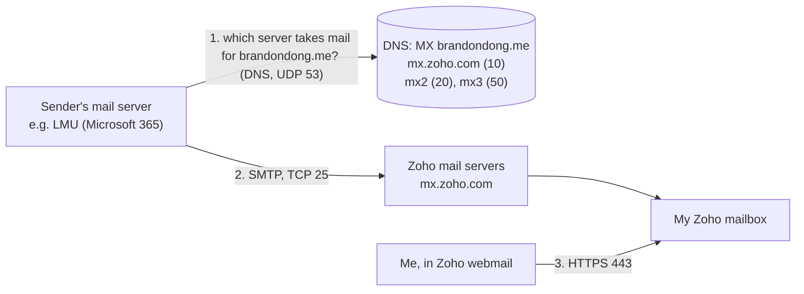
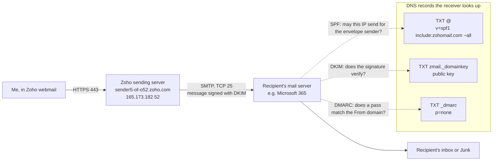
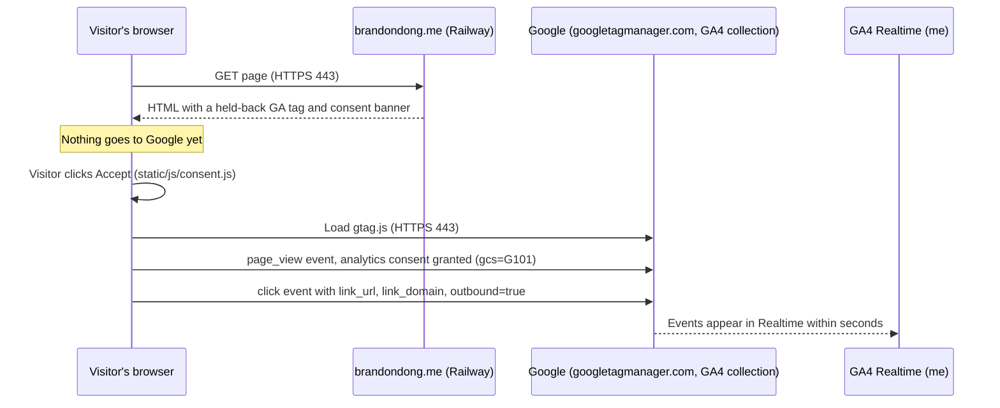

# Email and analytics paths

These paths are the same on Azure and Railway. Mail never touches the web host, and analytics events go from the visitor's browser straight to Google. Web request path: [request-path.md](request-path.md).

## Incoming mail

Before the MX records existed (before 2026-10-13 21:36:29 UTC), step 1 had no answer, so sending servers had nowhere to deliver.

## Outgoing mail and how the receiver checks it

The SMTP port between mail servers (25) is the standard one. I didn't capture it myself. The receiver's verdicts are in [zoho-header-check.md](../evidence/zoho-header-check.md).

## Analytics

If the visitor clicks Decline or makes no choice, the browser never loads `gtag.js` and sends nothing. Evidence: [ex06.md](../evidence/ex06.md) §3.
