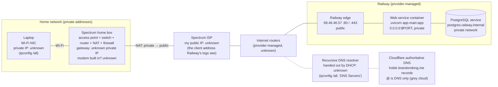
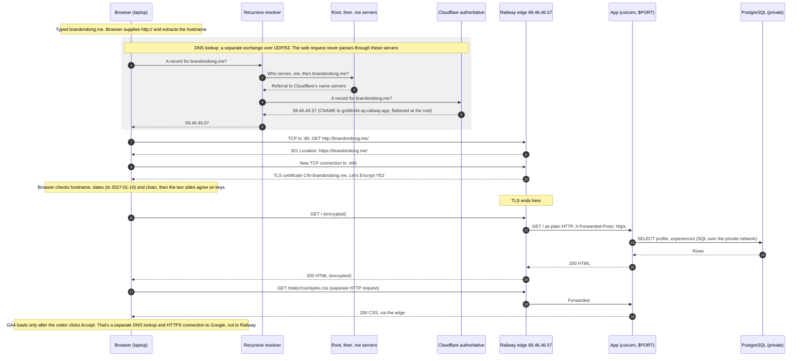
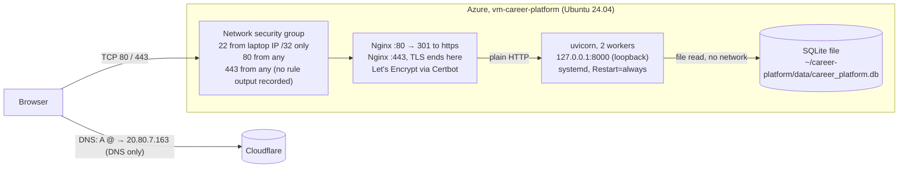

# What happens when you enter brandondong.me

Railway is the current host. Azure is the earlier host, described after it. Values marked **unknown** aren't recorded in this repository. Each one names the check that would fill it in.

**Assumptions:** a new HTTPS connection over TCP, no cached DNS answer, and `brandondong.me` typed with no scheme.

## 1. Physical path and addresses

The DNS lookup and the web request both cross this hardware. They are separate exchanges.

DHCP on the home box gives the laptop four settings: its private IP, the subnet mask, the default gateway, and the DNS server. The box rewrites the laptop's private source address to its public one (NAT) and remembers the flow, so it can map Railway's reply back to the laptop. Its firewall is stateful: it lets the reply in because it saw the request go out.

## 2. Request sequence on Railway

### Client and server on each connection

| Connection | Client | Server | Protocol and port | Public or private |
|---|---|---|---|---|
| DNS query | Laptop | Recursive resolver | UDP 53 | Crosses the internet unless the resolver is the home box |
| Recursive lookups | Resolver | Root, `.me`, Cloudflare name servers | UDP 53 | Public |
| Redirect | Browser | Railway edge | TCP 80, HTTP | Public |
| Web request | Browser | Railway edge | TCP 443, HTTPS (TLS) | Public |
| Edge to app | Railway edge | uvicorn | HTTP on `$PORT` | Private, inside Railway |
| Database | App (SQLAlchemy) | PostgreSQL | TCP, port from `DATABASE_URL` | Private, `postgres.railway.internal` |

**Why the app trusts `X-Forwarded-Proto`:** TLS ends at the edge, so the app receives plain HTTP. Without that header it builds `http://` stylesheet links, which browsers block on an HTTPS page (`app/main.py`).

**Why UDP for DNS and TCP for the site:** a DNS question and answer each fit in one small packet, and the client can just ask again if one is lost. A web page is a long, ordered byte stream that needs delivery guarantees, and TLS needs TCP underneath it.

**With a cached answer:** if the browser, the OS, or the resolver still holds `69.46.46.57` within its TTL, steps 1–6 are skipped or shortened. Everything from the TCP connection onward stays the same.

## 3. What changes on Azure (Sept 29 – Oct 16, 2026; decommissioned)

| Part | Railway | Azure |
|---|---|---|
| DNS answer for `@` | CNAME to Railway, flattened to `69.46.46.57` | A record `20.80.7.163` |
| Network filter | Railway's edge (provider) | Azure NSG rules I wrote |
| Where TLS ends | Railway edge, certificate renewed by Railway | Nginx on the VM, Certbot timer renews |
| App listener | `0.0.0.0:$PORT` inside the container | `127.0.0.1:8000`, reachable only from the VM itself |
| Database | PostgreSQL service over the private network | SQLite file on the same disk, no network hop |
| Keeping it running | Railway restart policy and health check (`/healthz`) | systemd `enable` + `Restart=always` |
| VM private IP | n/a | Unknown, never recorded |

**Localhost means different things on each host:** on Azure, `127.0.0.1:8000` is loopback on the VM, so only Nginx on that VM can reach uvicorn. On Railway, the app binds `0.0.0.0` so Railway's edge can reach the container from outside it.

## Sources

- Railway edge IP, DNS and certificate: [evidence/ex05.md](../evidence/ex05.md)
- DNS records and grey cloud: [evidence/dns-before-zoho.md](../evidence/dns-before-zoho.md)
- Railway service layout: [plans/2026-10-08-railway-migration.md](../superpowers/plans/2026-10-08-railway-migration.md)
- Azure Nginx, systemd and NSG: [plans/2026-10-01-operate-the-vm.md](../superpowers/plans/2026-10-01-operate-the-vm.md), [how-this-site-is-secured.md](../how-this-site-is-secured.md)
- Decommission: [railway-migration-results.md](../railway-migration-results.md)
