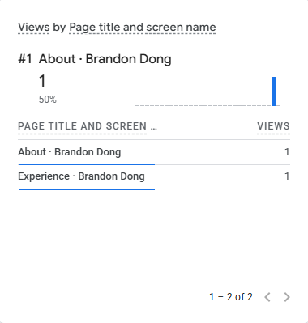
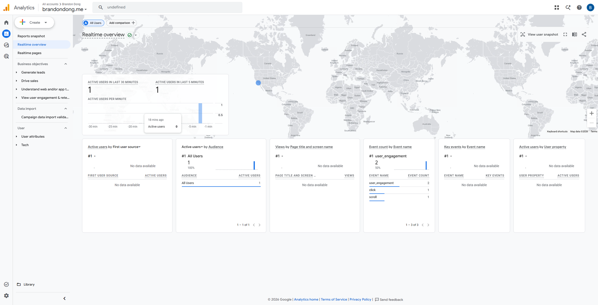
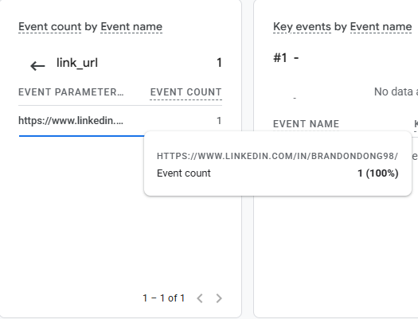
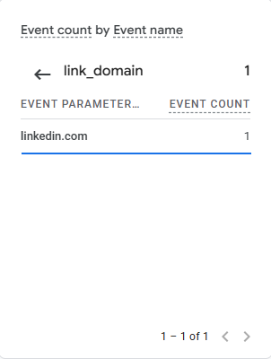
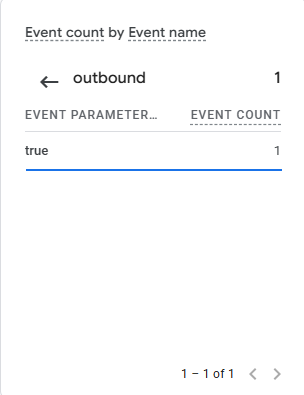

# Exercise 06: Domain email and Google Analytics

## 1. Email tests

Zoho Mail for my `brandondong.me` address. DNS is at Cloudflare; Zoho's MX, SPF, DKIM (`zmail` selector) and the DMARC record were added on 2026-10-13, and Zoho shows the domain and DKIM as verified. The website's records (`@` → Railway, `www` → redirect) were unchanged.

| Test | Time | Result |
|---|---|---|
| Before MX: external account → my domain address, before the first MX record (2026-10-13 21:36:29 UTC) | none recorded | **Not done.** The Zoho setup was done together in class, and I don't recall sending a message before the MX records were added, so there's no result to report. It can't be repeated honestly now without removing working mail records. *(Added 2026-10-21.)* |
| Received: LMU (Outlook) mailbox → my domain address, "Test 01: inbound" | 2026-10-13 2:53 PM PDT (21:53 UTC) | Arrived in the Zoho Inbox |
| Replied: from Zoho to "Test 01: inbound", to the LMU mailbox | 2026-10-19 2:25 PM PDT (21:25 UTC) | Arrived in the LMU **Inbox**, in the same conversation as Test 01, From shows my `brandondong.me` address |
| Sent a new message: Zoho → LMU (Outlook) mailbox, "Test 03: Outbound with DKIM" | 2026-10-13 3:08 PM PDT (22:08:54 UTC) | Arrived in the LMU mailbox, From shows my `brandondong.me` address, but it ended up in **Junk**. Microsoft's filter delivered it to the Inbox (`SCL:1`, `dest:I` in the headers), and it moved to Junk about a second later. Authentication passed (below), so I think the move came from my mailbox's junk filtering of a brand-new sender domain. Next step: mark it Not junk and add the address to Safe senders |

On 2026-10-19 the reply above went to the Inbox, but another new message sent the same day went to Junk again. Every message passes SPF, DKIM and DMARC, so authentication doesn't explain the difference. My reading: the reply belongs to a conversation my LMU mailbox started, while a new message comes from a domain only a few weeks old with no sending history, so it gets filtered as unknown. I haven't confirmed this, because the junk decision isn't recorded in the headers. Next step: mark the domain as a safe sender and watch whether later new messages reach the Inbox.

## 2. SPF, DKIM and DMARC

Outgoing message "Test 03", from the receiving LMU (Microsoft 365) mailbox's headers:

```text
Authentication-Results: mx.microsoft.com 1; spf=pass (sender IP is
 165.173.182.52) smtp.mailfrom=brandondong.me; dkim=pass (signature was
 verified) header.d=brandondong.me;dmarc=pass action=none
 header.from=brandondong.me;compauth=pass reason=100
Received-SPF: Pass (protection.outlook.com: domain of brandondong.me
 designates 165.173.182.52 as permitted sender)
 receiver=protection.outlook.com; client-ip=165.173.182.52;
 helo=sender5-of-o52.zoho.com; pr=C
DKIM-Signature: v=1; a=rsa-sha256; q=dns/txt; c=relaxed/relaxed; s=zmail; d=brandondong.me; ...
```

SPF, DKIM and DMARC all pass, and all three align with `brandondong.me` (DKIM signed with my `zmail` key, not Zoho's domain).

## 3. Google Analytics

- Live site: https://brandondong.me
- Privacy page: https://brandondong.me/privacy (linked from every page's footer)

The tag (`G-RBCK2JQ78P`) loads once per page, but Google's script is held back until a visitor clicks **Accept** in the site's banner. **Decline** or no choice sends nothing to Google; Cookie settings in the footer reopens the choice. I accepted in my own browser for these checks.

**`page_view`** (GA4 Realtime, 2026-10-19 ~21:18 UTC): page views for About and Experience, which GA4 counts from `page_view` events.



**`click`** on the LinkedIn link (GA4 Realtime overview, Event count by Event name):



**The click's destination details:**

| `link_url` | `link_domain` | `outbound` |
|---|---|---|
|  |  |  |

`link_url` is `https://www.linkedin.com/in/brandondong98/`, the link I clicked; `link_domain` is `linkedin.com`; `outbound` is `true`.

**What failed first:** my first test showed `click` but no `page_view`. The page view was being sent before the consent update, as a cookieless "denied" ping that Realtime doesn't show (`gcs=G100` in the request). Adding `wait_for_update` to the consent default made it wait for the Accept; the request then carried `gcs=G101` (analytics granted), and page views appeared in Realtime (commit `48f342a`).
