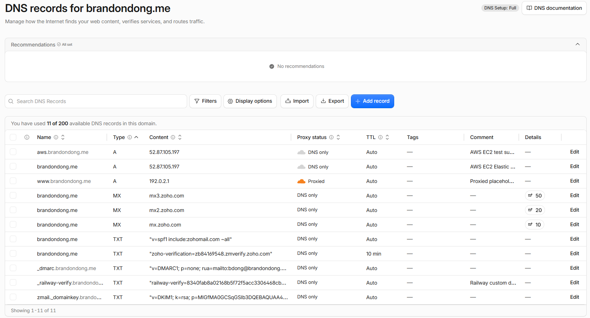
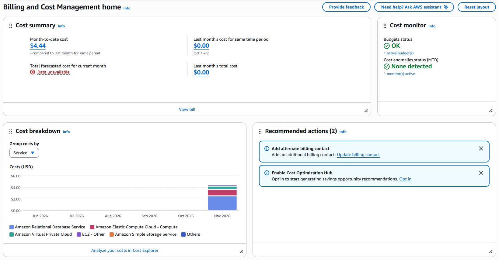

# Exercise 07: Migrate the site from Railway to AWS

Architecture diagram: [README → Architecture](../../README.md#architecture). The full record of every section, deviation and command result is in [docs/aws-migration-notes.md](../aws-migration-notes.md).

## 1. Architecture decision

I chose **EC2 with a Single-AZ RDS PostgreSQL database** over **EC2 with PostgreSQL on the instance**, so a failure on one server doesn't take the other down and the database isn't on the public-facing VM, and I accepted about $14/month more and one more service to set up and secure.

My first choice was local PostgreSQL to save money. My instructor approved that, then asked that this migration use RDS, so I changed it before provisioning.

## 2. Backup record

| Item | Result |
|---|---|
| Backup date | 2026-11-03 20:52 UTC: `pg_dump` 18.6 run inside Railway's Postgres container over `railway ssh`; the database was never exposed publicly |
| Where it's kept | Outside the repository on my laptop, plus a private Google Drive folder; SHA-256 checked after downloading the Drive copy back |
| Restore test | **Pass.** Restored into a new local `postgres:18.6` database in 836 ms with `pg_restore --exit-on-error` (exit 0). Row counts and content hashes matched the backup manifest for all 7 tables, and the app ran against the restored copy with every page 200. Railway wasn't queried during the check |
| Data loss I accept (RPO) | 7 days. Data only changes through my own edits, and any lost edit can be redone from my resume |
| Recovery time I accept (RTO) | 1 hour. The restore takes under a second; the time goes into provisioning and DNS |
| Backups on AWS | RDS automated backups for 7 days (daily snapshots from 2026-11-05 include my data), plus a weekly `pg_dump` export kept outside AWS |

## 3. Verification on the test subdomain

Tested at `https://aws.brandondong.me` (A record, DNS only) while Railway still served `brandondong.me`, 2026-11-04 to 2026-11-05 UTC.

| Test | Evidence | Result |
|---|---|---|
| Data moved intact | All 7 tables in RDS matched the Railway manifest's row counts and content hashes; sequences correct | Pass |
| HTTPS | Let's Encrypt certificate verified by `curl` and `openssl`; HTTP returns 301 to HTTPS with the path kept | Pass |
| Certificate renewal | `certbot renew --dry-run`: the first run failed with Let's Encrypt `rateLimited: Service busy; retry later`, before any domain check; one retry succeeded | Pass |
| Pages | `/`, `/about`, `/experience`, `/projects`, `/skills`, `/credentials`, `/contact`, `/privacy`, `/healthz`, CSS and JS all 200 with real data; unknown path 404 | Pass |
| Same content as Railway | All 8 pages compared with the live Railway site: same content apart from the host text and blank lines on two pages | Pass |
| Admin login | No login, the public default login and a wrong password: 401. My real login: 200 | Pass |
| Database privacy | RDS `PubliclyAccessible = false`; port 5432 closed from my laptop; only the web security group can connect | Pass |
| App database login | Read-only `career_app` role over TLS 1.3 with `sslmode=verify-full`; update, delete and create table refused | Pass |
| Exposure | Bare IP, unknown hostnames and port 8000 closed from my laptop | Pass |
| Reboot | Site back in 22 s; systemd started the app 7 s after boot with no login | Pass |
| App crash (`kill -9`) | 502 for a few seconds, then systemd restarted it and `/healthz` returned 200 within 6 s | Pass |
| App stopped | Nginx stayed up and returned `502 Bad Gateway`, with `Connection refused` in its error log | Pass |
| Database cut off | Pages returned 503 in about 10 s instead of hanging; recovered without an app restart once access returned | Pass |
| Backup from AWS | `pg_dump` from RDS restored locally; all 7 tables matched | Pass |
| Point-in-time restore of RDS | Not attempted | Not verified |

## 4. Cutover status

**Done on 2026-11-05 at 01:18:55 UTC** (2026-11-04, 5:18 PM Pacific). The `brandondong.me` record changed from `CNAME gvb8rrd4.up.railway.app` to an A record for the EC2 Elastic IP, DNS only, using the Cloudflare CLI. The certificate covered the root domain 28 seconds later.

After cutover: three public resolvers returned the new address, every page returned 200 over HTTPS, `www` still redirected, only the root record changed (plus the added `aws` record), and test emails went through Zoho in both directions.

## 5. Cost

| | Monthly |
|---|---|
| Section 6 estimate (us-east-1 public prices, 2026-11-03) | **$26.82**: RDS $11.68, EC2 $7.59, public IPv4 $3.65, RDS storage $2.30, EC2 storage $1.60 |
| Budget alert | $10/month, so it fires partway through each month. Alerts aren't a spending cap |

The account is on the paid plan with no credits (Billing → Credits showed $0.00), so this is real money. I recorded that restriction, discussed it with my instructor, and chose to pay for it. The account owner's billing page showed **$4.44 month-to-date on 2026-11-09** (screenshot below), about 6 days into running both servers, which is in line with the estimate of about $0.88 a day. The forecast for the month wasn't available yet.

